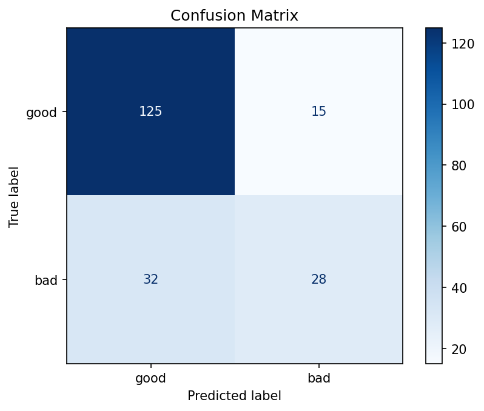
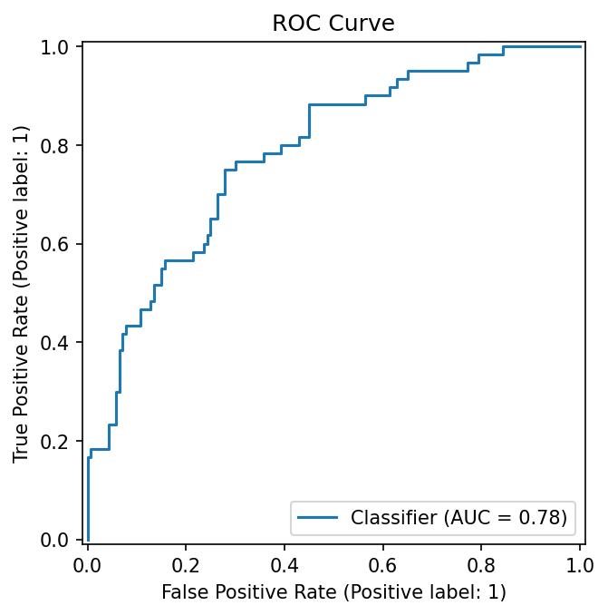
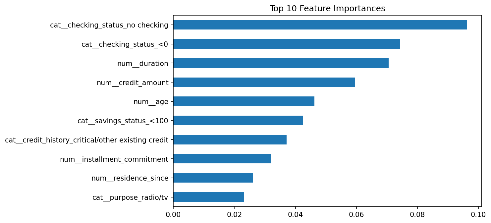

# Credit Scoring & Loan Default Prediction

A machine learning project that predicts whether a loan applicant is a good or bad credit risk.

## Dataset
German Credit dataset (1,000 applicants, 20 features) from OpenML / UCI.
About 70% good and 30% bad credit risks.

## Approach
1. Split data into 80% train and 20% test (stratified)
2. Scaled numeric features and one-hot encoded categorical features
3. Applied SMOTE on the training data only, inside a pipeline, to handle class imbalance without data leakage
4. Trained a Random Forest classifier (300 trees)
5. Evaluated with 5-fold cross-validation and a held-out test set

## Results (test set, 200 applicants)

| Metric | Value |
|---|---|
| Accuracy | 76.5% |
| ROC-AUC | 0.78 |
| Precision (bad loans) | 65% |
| Recall (bad loans) | 47% |
| F1-score (bad loans) | 0.54 |

### Confusion Matrix


### ROC Curve


### Top Features


## Key Insights
- Checking account status, loan duration, credit amount, age and savings are the most important factors.
- The model catches fewer than half of the risky applicants (recall 47%), so it is better at confirming good applicants than finding bad ones.
- Lowering the decision threshold or using class weights could improve recall at the cost of precision.

## How to Run
```bash
pip install scikit-learn imbalanced-learn pandas matplotlib joblib
python credit_scoring.py
```
The dataset downloads automatically. The trained model is saved as `credit_model.joblib`.

## Tech Stack
Python, Pandas, Scikit-learn, Imbalanced-learn (SMOTE), Matplotlib

## Future Work
- Improve recall on bad loans by tuning the threshold
- Add a Flask REST API for predictions
